<!--
  LIGHT & DARK // CLASSIFIED ARCHIVE // README v8.0 (the "we cut 60%, you're welcome" edition)
  If you're reading the source: hi. Yes, we saw you. No, you still can't have our faces.

  FOLDER LAYOUT (keep it or the pictures break):
  README.md
  assets/*.svg  (header, divider, classified, progress, footer, h01-h07, quote, protocol)
-->

<div align="center">


<br>


<br>


<br><br>

`▓▒░ THE INTERNET WAS TOO PEACEFUL ANYWAY ░▒▓`

<br>

**[`01 ORIGIN`](#s01)** · **[`02 PROJECT`](#s02)** · **[`03 HARDWARE`](#s03)** · **[`04 TWO SIDES`](#s04)** · **[`05 TERMINAL`](#s05)** · **[`06 RULES`](#s06)** · **[`07 FAQ`](#s07)**

</div>

> [!WARNING]
> May cause laughter, curiosity, and an uncontrollable urge to ⭐ this repo. We accept zero liability.


<div align="center">


</div>

<a name="s01"></a>

<h2 align="center">We're <u>Light &amp; Dark</u>.<br>Two bros. Best friends.<br><i>Future software legends.</i></h2>

<p align="center"><sub><i>("Future" is doing some heroic heavy lifting there.)</i></sub></p>

We're anonymous because privacy matters, mystery is cool, and our parents said not to talk to strangers online.

So naturally, we started a company. On the internet. With strangers.

<h3 align="center">🏆 Award-winning logic. 🏆</h3>

<div align="center">


</div>

| Suspect | Known activities |
|---|---|
| 🌑 **Dark** | Has an idea. Refuses to explain it. |
| 🌕 **Light** | Asks questions. Immediately regrets it. |
| ☕ **Coffee** | The only employee who shows up. |

We're not the next billion-dollar company. *(Yet. We're not rude.)*


<a name="s02"></a>

<div align="center">


<br>


<br><br>

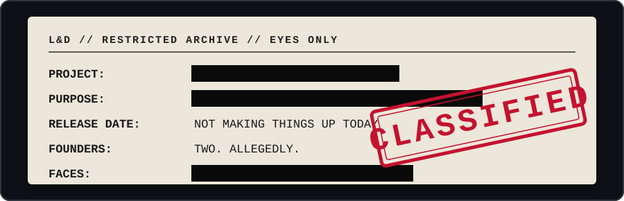

</div>

| 🙋 You ask | 🕶️ We say |
|---|---|
| **What is it?** | Classified. |
| **When does it launch?** | When it's ready. We don't invent dates to look productive. *(Looking at you, every startup.)* |
| **Can I get a hint?** | It's software. It runs on a device. You're welcome. |

- [x] Have an idea at an unreasonable hour.
- [x] Make it ten times more complicated.
- [x] Say "this will take a week."
- [ ] Stop adding "one tiny feature."
- [ ] Ship it.
- [ ] Remember what sunlight looks like.

<div align="center">


</div>

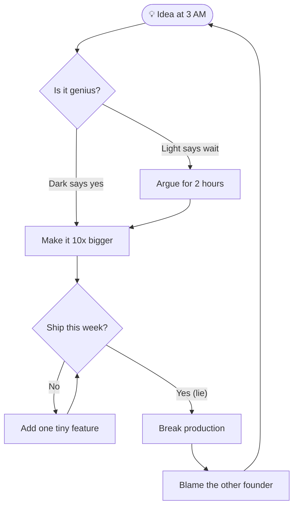

<div align="center">


</div>


<a name="s03"></a>

| System | Diagnostics |
|---|---|
| 🎮 PC gaming | *"Last match."* A historical work of fiction. |
| 🎧 Music | Headphones on. Human interaction disabled. |
| 🏎️ Cars | The dream garage costs more than our current life. |
| 💻 Coding | One missing bracket from a villain origin story. |
| ☕ Caffeine | Our technical co-founder. Has equity. |

<div align="center">


</div>

```text
[AMBITION]    ██████████ 100%
[COFFEE]      ██████████ CRITICAL
[SLEEP]       ░░░░░░░░░░  0%
[DEADLINES]   DEPENDS WHO YOU ASK
[DOCS]        "WE'LL WRITE THEM LATER"
```

```text
d4e5f6a  chore: no idea. it works now. do not touch
c7d8e9f  fix: fixed the fix
0a1b2c3  revert: we were wrong, the first thing was fine
b7c8d9e  feat: one tiny feature (we promised we'd stop)
```


<a name="s04"></a>

Why **Light & Dark**? Every great story has two sides. One brings the light. One embraces the dark.

Or we just thought the name sounded sick.

<h3 align="center">🤫 THE TRUTH IS CLASSIFIED. 🤫</h3>

| | 🌕 LIGHT | 🌑 DARK |
|---|---|---|
| **Energy** | "Let's think this through." | "Let's just do it." |
| **Sleep** | Tries. Fails. | Never heard of it. |
| **Bugs** | Calm debugging. | Blames Light. |
| **Features** | "Do we need this?" | "Add it." |

<div align="center">


</div>


<a name="s05"></a>

```console
light-dark@classified:~$ whoami
> Two bros hiding behind one very suspicious brand.

light-dark@classified:~$ reveal_identity
> ACCESS DENIED [403]. Try again after the heat death of the universe.

light-dark@classified:~$ sudo reveal_identity
> Nice try. We don't even trust ourselves with sudo.

light-dark@classified:~$ launch_product
> ERROR 418: FOUNDERS ARE STILL COOKING. Please provide snacks.

light-dark@classified:~$ assign_blame
> OTHER_FOUNDER
```

<div align="center">


</div>


<a name="s06"></a>

<div align="center">


</div>


<a name="s07"></a>

<details>
<summary><b>❓ Are you hiring?</b></summary>
<br>
We pay in coffee, vibes, and 3 AM voice calls. Competitive.
</details>

<details>
<summary><b>❓ What's your real name?</b></summary>
<br>
Section 05, <code>reveal_identity</code>. Read it again, slower.
</details>

<details>
<summary><b>❓ How do I support you?</b></summary>
<br>
Smash ⭐. It's free, takes one second, and tells Dark his 3 AM ideas weren't a waste of electricity.
</details>

<details>
<summary><b>🥚 You found the secret section. Now what?</b></summary>
<br>
Nothing. You win nothing. But you read the whole thing, which makes you more committed than most of our future users. We respect it.
</details>


<div align="center">

<h3>🛠️ First release? When it's ready. No fake dates, no empty promises, no rented supercars in motivational posts.</h3>

</div>

> [!TIP]
> The most important button on this page is the ⭐ at the top right. Somewhere, a founder is staring at a screen at 3 AM waiting for a sign that this was worth it.

<div align="center">

<br>


<br>


<br><br>

# LIGHT & DARK

### REMEMBER THE NAME. FORGET THE FACES.

<sub>© LIGHT & DARK · Built in the shadows, released into the light.</sub>

<br>

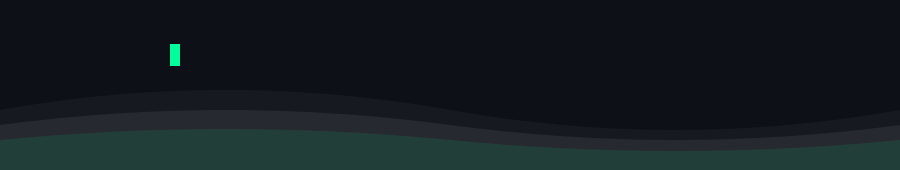

</div>
